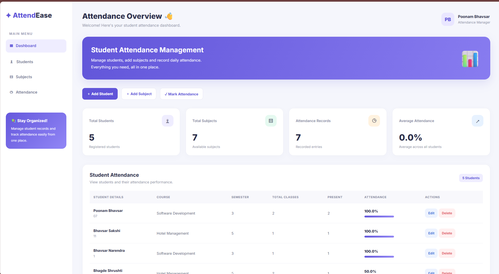

# Student-Attendance-Management-System-CRUD

# Student Attendance Management System

**College Practical Assignment — Question 2**

## 📌 About the Project

This project is developed as part of my college practical assignment to practice Django web development and CRUD operations.

The Student Attendance Management System helps manage student details, subjects, and attendance records using Django.

## 📸 Project Screenshots

### 1. Dashboard



### 2. Student Attendance


### 3. Attendance Records


## ✨ Features

* Add, view, edit, and delete student records.
* Manage subjects.
* Record and manage student attendance.
* Calculate student attendance percentages.
* Manage records through the Django Admin Panel.
* User-friendly dashboard.

## 🛠️ Technologies Used

* **Frontend:** HTML, CSS
* **Backend:** Python, Django
* **Database:** SQLite
* **Admin Panel:** Django Administration

## ⚙️ Installation and Setup

### 1. Clone the Repository

```bash
git clone https://github.com/BhavsarPoonam1409/Student-Attendance-Management-System-CRUD.git
```

### 2. Navigate to the Project Folder

```bash
cd Qus2_Student_Attendance_Management_System
```

### 3. Install Django

```bash
pip install django
```

### 4. Apply Migrations

```bash
python manage.py migrate
```

### 5. Create an Admin Account

```bash
python manage.py createsuperuser
```

### 6. Run the Project

```bash
python manage.py runserver
```

Open the application at http://127.0.0.1:8000/

## 🔐 Django Admin Panel

Access the admin panel at http://127.0.0.1:8000/admin/

Log in using your superuser credentials to manage student, subject, and attendance records.

## 🎯 Objective

The objective of this assignment is to understand Django fundamentals, CRUD operations, database management, and the use of the Django Admin Panel.

## 👩‍💻 Author

**Poonam Bhavsar**
M.Sc. IT (Software Development)
Gujarat University

